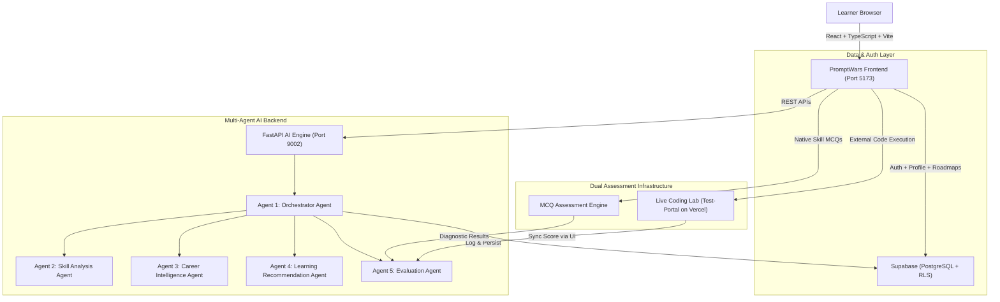

# PromptWars – AI-Powered Personalized Learning & Career Intelligence Platform

A complete, unified, AI-orchestrated learning and career intelligence platform designed for the **PromptWars Hackathon**. The platform analyzes an individual's real skills, calculates transparent career readiness scores against market-calibrated benchmarks, orchestrates multi-agent personalized learning roadmaps, conducts skill validation assessments, and dynamically adapts whenever career goals change or assessment weaknesses are identified.

---

## 🌟 Key Features & Problem Statement Coverage

| Problem Statement Pillar | Implementation & Capabilities |
|---|---|
| **Module 1: User Profile** | Full learner identity: degree, institution, career target, skills, certifications, and completed project portfolio. |
| **Module 2: Skill Analysis** | Calibrate self-reported proficiencies (0-100%), verified badges, category filtering, and empirical assessment validation. |
| **Module 3: Career Matching** | 9 industry-calibrated career roles with transparent, weighted readiness formulas, surplus strengths, and prioritized gaps. |
| **Module 4: Personalized Roadmaps** | Multi-phase curriculum tailored to learner gaps with real, verified documentation links (MDN, React Docs, fast.ai, etc.). |
| **Module 5: Progress Tracking** | Learner Cockpit dashboard with readiness gauge, skill radar, milestone progress, and learning hours velocity. |
| **Module 6: Context-Aware AI Mentor** | Real-time conversational AI mentor grounded in live learner database state (career goal, readiness %, gaps, current phase). |
| **Multi-Agent Architecture** | 5 specialized collaborating agents: **Orchestrator**, **Skill Analysis**, **Career Intelligence**, **Learning Recommendation**, and **Evaluation**. |
| **Dual Assessment Engine** | **Track A:** Native diagnostic MCQs mapped to skill topics.<br>**Track B:** Specialized interactive Coding Lab (running live with compiler and test cases at `https://test-portal-sage.vercel.app`). |
| **Dynamic Adaptation** | **Scenario A (Career Change):** Archives old roadmap, recalculates gaps, transfers verified skills, and creates a new path.<br>**Scenario B (Poor Assessment):** Evaluation Agent identifies weak concepts and automatically patches active roadmap with remedial modules. |

---

## 🏗️ System Architecture



---

## 🚀 Quick Start Guide

### 1. Frontend Setup (`promptwars`)

```bash
cd d:\PromptWar2\promptwars

# Install dependencies
npm install

# Start development server
npm run dev
```

Frontend will be available at: `http://localhost:5173`

### 2. AI Multi-Agent Backend Setup (`promptwars-ai`)

```bash
cd d:\PromptWar2\promptwars-ai

# Create virtual environment (optional)
python -m venv venv
.\venv\Scripts\activate

# Install dependencies
pip install -r requirements.txt

# Run FastAPI backend
python main.py
```

AI API will be available at: `http://localhost:9002`  
Interactive Swagger Docs at: `http://localhost:9002/docs`

---

## 🗄️ Database Migrations (Supabase)

All SQL migrations and seed datasets are located in `promptwars/supabase/migrations/`:
1. `20261114000001_promptwars_schema.sql` — Profiles extension, skills catalog, learner skills, career roles, roadmaps, phases, activities, assessments, questions, logs, and RLS policies.
2. `20261114000002_seed_data.sql` — Pre-seeds 25+ verified skills, the 9 target career roles with weighted benchmarks, and diagnostic question banks.

---

## 🎬 End-to-End Hackathon Demonstration Scenario

Follow these steps during your judging presentation:

1. **Register a New Student**:
   - Navigate to `/register`.
   - Sign up with Name: *Alex Morgan*, Degree: *B.Tech CS*, University: *Tech University*.
2. **Configure Baseline Skills**:
   - Navigate to `/skills`.
   - Verify initial self-reported skills: Python (70% - Intermediate), SQL (65% - Intermediate), HTML (40% - Beginner), CSS (40% - Beginner).
3. **Select Target Career (Full Stack Developer)**:
   - Navigate to `/careers`.
   - Inspect *Full Stack Developer* and click **Set as Goal**.
4. **Inspect Career Readiness & Skill Gaps**:
   - Navigate to `/careers/:id/readiness`.
   - Demonstrate the transparent readiness score calculation:
     - Strengths: Python, SQL.
     - Critical missing skills identified: JavaScript, React, Node.js.
5. **Inspect Multi-Agent Generated Learning Roadmap**:
   - Navigate to `/roadmap`.
   - Show how the **Learning Recommendation Agent** scheduled Phase 1 specifically around the primary gaps (JavaScript & React) with verified MDN and React documentation links.
6. **Take an Assessment**:
   - Navigate to `/assessments`.
   - Launch the *JavaScript Core Proficiency Assessment*.
   - Answer the diagnostic questions and submit.
7. **Demonstrate Adaptive Remediation (Scenario B)**:
   - In `/assessments/:id/results`, if score < 60%, show the **Evaluation Agent** isolating weak topics (e.g. Closures, Event Loop) and dynamically inserting remedial activities into the active roadmap.
8. **Demonstrate Career Goal Change (Scenario A)**:
   - Navigate to `/careers` and switch goal to **Data Scientist**.
   - Show the platform immediately recalculating readiness (Python & SQL now register as primary core strengths!), archiving the Full Stack roadmap in version history, and generating an adaptive Data Science roadmap.
9. **Engage the Context-Aware AI Mentor**:
   - Navigate to `/mentor`.
   - Ask: *"What should I learn today based on my gaps?"*
   - Show how the mentor responds referencing your exact target career, readiness index, and active roadmap milestone.
10. **Demonstrate Specialized Coding Lab**:
    - In `/assessments`, click **Open Coding Lab** to showcase real multi-language compilation (C, C++, Java, Python) with automated test cases on `https://test-portal-sage.vercel.app`, and synchronize results back into the platform.

---

## 🔒 Security & Deployment Best Practices
- Supabase anonymous key is restricted to public client operations with Row Level Security (RLS).
- Privileged operations and LLM keys are held exclusively inside the Python FastAPI environment.
- Deterministic scoring algorithms ensure that career readiness numbers are mathematically grounded and un-hallucinated.

